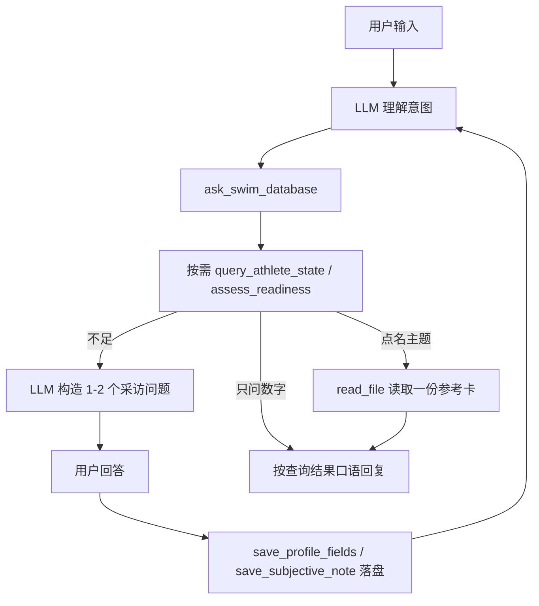
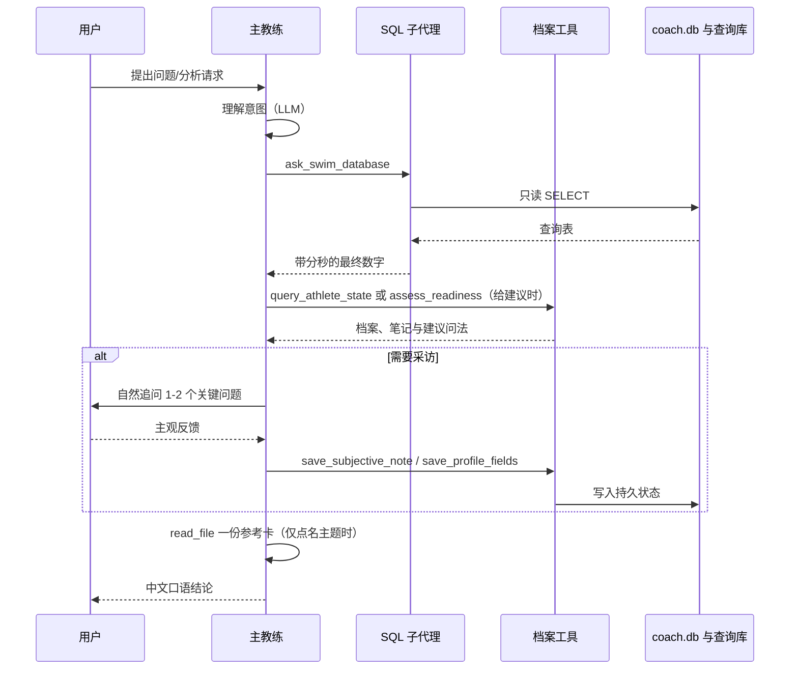
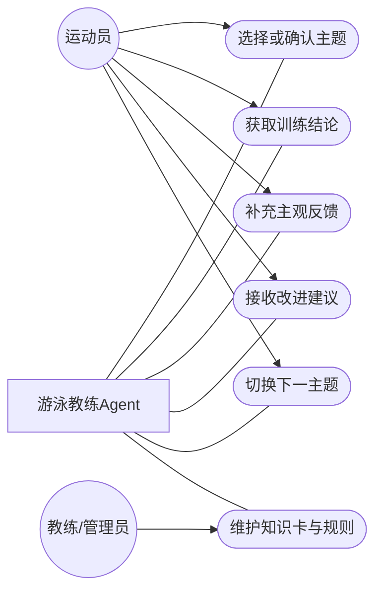
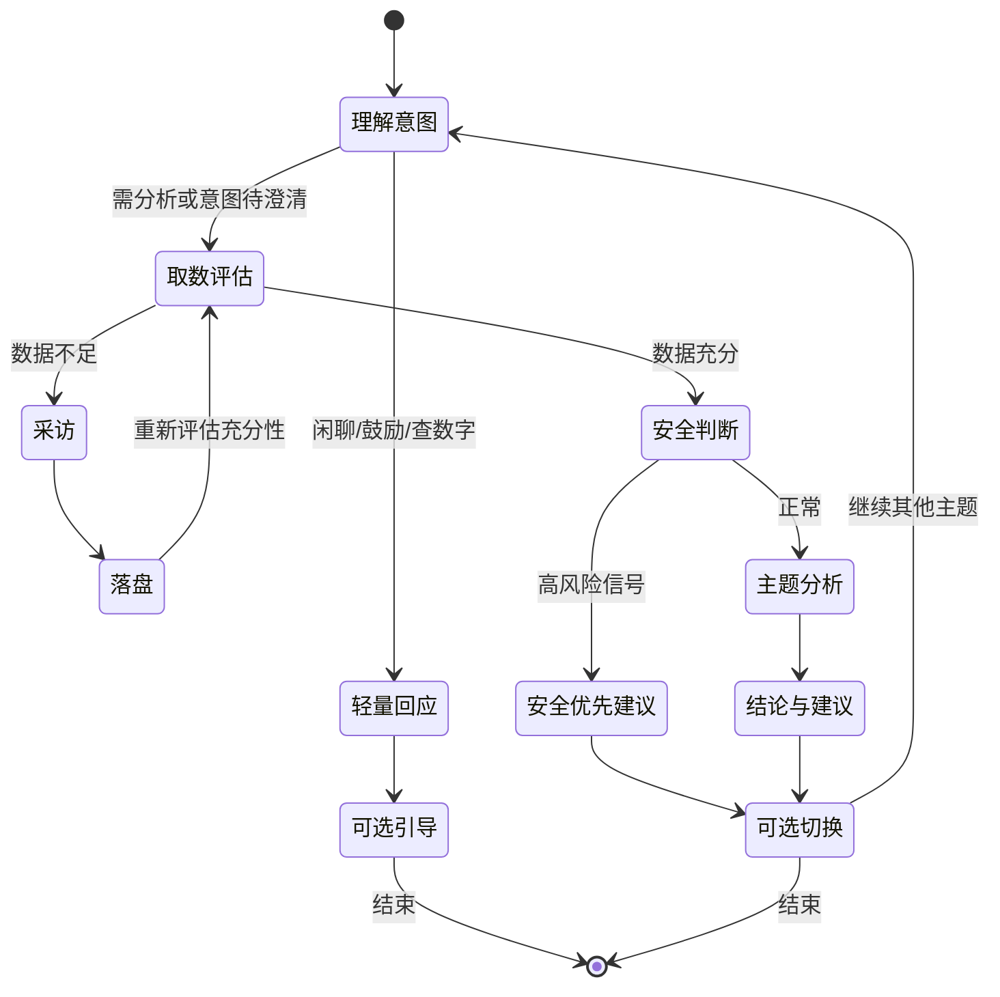

# 游泳教练 Agent 设计文档

| 项       | 内容                                                   |
| -------- | ------------------------------------------------------ |
| 文档类型 | 产品设计与技术方案（PRD + SDD）                        |
| 所属项目 | Garmin 私有运动数据语音分析终端                        |
| 文档对象 | 游泳教练 Agent                                         |
| 版本     | 1.0（第一版实现）                                      |
| 日期     | 2026-10-19                                             |
| 关联文档 | `docs/项目文档：Garmin 私有运动数据语音分析终端.md`  |
| 外部依赖 | [tcgoetz/GarminDB](https://github.com/tcgoetz/GarminDB) |

---

## 1. 产品定位与目标

### 1.1 产品定位

游泳教练 Agent 是面向业余游泳训练者的本地智能分析系统。系统以 Garmin 客观训练数据为基础，结合交互式采访获取主观信息，在单次会话内完成主题化诊断与建议输出。

### 1.2 核心目标

1. 把“只回答问题”升级为“理解意图 + 按需采访 + 分析 + 建议”的教练式多轮交互。
2. 主教练负责口语、采访和主题建议，训练数字交给 SQL 子代理现查，不靠关键词路由。
3. 通过状态复用减少重复提问，提升用户连续使用意愿。
4. 以结构化工具与可复算证据约束输出，在灵活性与可信度之间取得平衡。

### 1.3 成功标准

1. 单主题会话中，采访问题控制在 1-2 题/轮，不刷屏。
2. 主题分析结论必须可追溯到客观数据与主观回答。
3. 相同主题二次分析时，重复提问率显著下降。

### 1.4 范围边界

| 纳入范围 | 不纳入范围 |
| --- | --- |
| 泳池游泳主题分析、主观采访、复盘与建议 | 水下视频动作识别 |
| Profile / Performance / Subjective 状态维护 | 医疗诊断、用药建议 |
| C0 训练建议模板输出与归档 | 自动回写 Garmin Connect |
| 与 FastAPI / Jupyter / ESP32 文本接口对接 | 固件、ASR、TTS 细节实现 |

---

## 2. 主题化分析产品设计

### 2.1 主题目录（内置 5 个）

1. 游泳效率分析（SWOLF + 划频 / 划幅）
2. 有氧耐力与疲劳漂移分析
3. 动作稳定性与不对称风险分析
4. 训练负荷与过度疲劳 / 伤病风险分析
5. 训练周期与进步趋势分析

### 2.2 主题工作模式

1. 用户选择主题或由系统识别主题意图。
2. 系统仅收集该主题所需信息，不跨主题扩问。
3. 信息充分后输出该主题报告，并提示是否切换下一主题。

### 2.3 交互策略

1. 每轮先回答用户当前问题，再进行补充追问。
2. 每轮最多 1-2 个问题。
3. 用户明确拒绝、时间紧或问题紧急时，暂停追问。
4. 追问优先级：安全与限制 > 主题关键缺口 > 泛化背景信息。

---

## 3. 数据源与指标口径

### 3.1 数据源分层

| 类型 | 来源 | 用途 |
| --- | --- | --- |
| 客观训练数据 | GarminDB + Connect CSV | 事实与规则计算 |
| 主观训练数据 | 对话采访回答 | 解释与个体化建议 |
| 状态数据 | `coach.db` 持久状态 | 跨会话复用与去重提问 |

### 3.2 CSV 主源口径

1. 摘要行（`间歇训练=摘要信息`）作为整场主口径（含休息）。
2. 子圈行（如 `1.1`、`5.2`）作为游动段技术剖面口径。
3. 休息行（`泳姿=休息`）作为恢复与休息管理口径。

### 3.3 口径使用规范

1. 对外默认报告采用整场主口径。
2. 技术原因解释可引用子圈剖面口径。
3. 恢复与疲劳判断必须纳入休息口径。
4. 子圈重算用于剖面分析与一致性校验，不替代整场主口径。

### 3.4 多场与周期口径

1. 单场分析读取 `activity_evidence` 中该场 evidence。
2. 周期和单场的训练数字都由 SQL 子代理按当轮问题查询，不把全部单圈预先塞进对话。
3. 时间窗口以当前日期为锚点；配速与 SWOLF 以首场对末场判断改善/退步（数值越小越好）。
4. 开发期多场数据：统一以 Garmin 导出的泳池 CSV 为唯一数据源，由 `scripts/build_fixtures_from_csv.py` 从零重建 `garmin_activities.db`（仅 `activities` 表）并落 evidence，各历史活动使用模拟 `start_time`。不再依赖 FIT/TCX。对话时由 evidence 和活动开始时间重建只读查询库。

---

## 4. 状态体系与存储设计

### 4.1 存储布局

```text
<DataRoot>/
├── garmin.db
├── garmin_activities.db
├── garmin_monitoring.db
├── garmin_summary.db
└── coach.db
```

### 4.2 `coach.db` 表分组

| 分组 | 表 | 说明 |
| --- | --- | --- |
| 增强事实 | `swim_lengths`、`swim_laps_enriched`、`activity_evidence` | 活动增强事实与证据 |
| 状态 | `athlete_profile`、`performance_state`、`subjective_memory` | 可复用状态 |
| 处方 | `workout_plans` | 建议模板归档 |
| 运行日志 | `coach_runs`（可选） | 调试与审计 |

### 4.3 状态分层

1. 持久状态（SQLite）：跨会话复用，由工具显式读写（profile / performance / subjective）。
2. 短期记忆（Agent Checkpointer）：当前会话的多轮消息上下文，由 LangGraph `checkpointer` + `thread_id` 维护，不手工拼接。
3. 临时状态清理：会话结束或切换运动员时更换 `thread_id`，持久状态保留在 SQLite。

### 4.4 状态字段治理

1. 档案和主观笔记由工具参数写入 SQLite。第一版没有单独的字段级 Schema 校验。
2. `updated_at` 由仓库写入。`source`、`confidence`、`ttl_days` 尚未落地。
3. 缺口识别目前看档案字段是否为空，不按过期时间追问。

---

## 5. Agent 架构（主教练 + SQL 子代理）

### 5.1 架构选型

系统采用 Deep Agents，由 `create_deep_agent` 构建。流程、口语和主题知识在 `agent/skills/swim-coach/`，业务工具通过 `tools` 参数挂载。放弃手写状态机（硬编码节点 + 关键词路由）的原因：

1. 关键词路由对自然表达鲁棒性差，换一种说法即误判。
2. 固定节点流转与固定问题库使对话僵硬，无法发挥 LLM 的意图理解与自然采访能力。
3. `create_deep_agent` 底层仍是 LangGraph，工具编排和本进程内的短期记忆不用再手写图。

因此流程控制从“图结构”下沉为“System Prompt + 技能正文 + 工具契约”。技能全文每轮都写进系统提示词。主教练判断意图、决定是否采访，训练数字只来自 SQL 子代理当轮返回的结果。

### 5.2 核心交互循环

Agent 每轮按系统提示词中的固定顺序思考。程序不做关键词意图识别，也不把训练数字预先写入提示词。

```text
用户提问
→ 意图分析（单场 / 最近 N 场 / 一段时间；要不要个人背景）
→ 查询数据（ask_swim_database，把用户问题原样传入；给建议前再查 query_athlete_state）
→ 若要给训练建议且长期状态不足：采访 1-2 问，并 save_profile_fields / save_subjective_note
→ 用户点名主题后，read_file 只读一份参考卡
→ 校验（数字必须来自本次或本会话已返回的查询结论，配速沿用分秒，划次不再除）
→ 中文口语回复
```



### 5.3 控制手段（替代图节点）

| 控制目标 | 实现方式 |
| --- | --- |
| 意图理解 | LLM 推理（System Prompt 约束到 5 主题范围），不用关键词路由 |
| 数据充分性 | `assess_readiness` 工具返回结构化缺口与建议问题，LLM 决定是否采访 |
| 采访节奏 | System Prompt 约束“每轮最多 1-2 问、已答不重复、紧急/拒绝则暂停” |
| 数值可信 | 整场配速、SWOLF 来自 evidence；圈级问题由 SQL 子代理现查。教练不心算，不改分秒 |
| 知识注入 | 用户点名主题后，用 `read_file` 读取 `skills/swim-coach/references/` 中的一份参考卡 |
| 短期记忆 | `InMemorySaver` + `thread_id` 维护当前进程内的多轮上下文 |
| 持久状态 | `save_profile_fields` / `save_subjective_note` 显式写 SQLite |
| 安全兜底 | System Prompt 禁医疗诊断；疼痛/胸闷等高风险信号优先给保守建议 |

### 5.4 采访与充分性策略

1. 每轮最多 1-2 问，优先级：安全与限制 > 当前主题关键缺口 > 泛化背景。
2. `assess_readiness` 先读持久状态去重，已持久化且未过期字段不再追问。
3. 问题文本由 LLM 结合语境自然生成，工具只提供“建议问法”作参考。
4. 采访可随时中断，持久状态保留，下次会话凭 `thread_id` 续接。

### 5.5 意图处理策略

Agent 由 System Prompt 指导完成意图归类，不再使用显式两级路由节点：

| 用户请求特征 | Agent 行为 | 回复方式 |
| --- | --- | --- |
| 明确“做某主题分析” | 拉数、按需采访，再读一份参考卡 | 比默认稍长的口语，仍不分节 |
| 宽泛提问（如“最近游得怎么样”） | 先给简短概览，再问先听哪个主题 | 默认两三句 |
| 仅要鼓励/闲聊 | 情绪价值回应，可选引导 | 默认两三句 |
| 仅查基础数字 | 调用一次 SQL 子代理后直接回答 | 默认两三句 |
| 意图不明确 | 主动澄清，把话题收敛到 5 个主题 | 默认两三句，最后只问一个问题 |

### 5.6 单轮交互时序图



### 5.7 用例关系图



### 5.8 会话状态机图

状态由 Agent 推理驱动，以下为逻辑状态（非硬编码节点）：



### 5.9 查询结果与防幻觉

训练数字不预先写入系统提示词。主教练不写 SQL，只调用一次 `ask_swim_database`，把用户问题原样传入。

1. 每次调用前，程序把 `activity_evidence`、`swim_laps_enriched` 和活动开始时间复制到 `agent/data/swim_sql.db`。这是可重建的只读缓存，不是另一份源数据。
2. 查询库两张表：`swim_sessions` 一行一场，整场配速用 `avg_pace_text`，不用单圈平均代替；`swim_laps` 一圈一行，`pace_per_100m_s` 是秒每 100 米，`elapsed_s` 才是这一圈用时，`total_strokes` 已是这一圈约 30 米的划次。
3. SQL 子代理按 LangChain SQL Agent 的工具循环工作。四个工具是 `sql_db_list_tables`、`sql_db_schema`、`sql_db_query_checker`、`sql_db_query`。表结构已写在子代理提示词里，平时只绑定检查和执行。当前模型在自动选择工具时，第一次工具返回后会空回复，因此用 `tool_choice="required"` 强制下一步。
4. 只允许一条 `SELECT` 或 `WITH`。禁止写入、多语句和 `PRAGMA`。单次最多 30 行。子代理调用带 `nostream`，SQL 原文不进入用户看见的回复。查数据时界面只说一次「好的，请稍等，我先看看您的训练数据。」
5. 交回主教练的是查询表整理后的最终数字：配速写成「1分48秒/100米」，划次保持每圈次数。用户要求从早到晚时，按时间列重排后再返回。不再让模型把这张表转述一遍。
6. 前后半程先按泳姿过滤，再用 `ROW_NUMBER()` 对半，不用固定的 `lap_index` 切整场。
7. 教练回复里的每个数字都要能在该结论里找到。配速和 SWOLF 越小越好。没有记录就说没有记录。结论里没有的指标不说，尤其是呼吸频率、每分钟划频、划幅、摄氧量、乳酸、步频、功率。
8. 短期对话由 checkpointer 保留，同一问题的结论可以沿用，不另做查询工具，也不灌进系统提示词。

### 5.10 长期状态与回复风格

1. 长期状态（档案、滚动表现、主观笔记）由 `query_athlete_state` 按需读取，返回 JSON。给训练建议或决定是否采访时才调用。
2. 默认两三句。只有用户点名主题并要求展开时才多说几句。不再用关键词选择风格层。

---

## 6. 主题规格（示例与模板）

### 6.1 主题资料

第一版没有独立的主题配置对象，也没有问题库或报告模板。运行时读取的是 `agent/skills/swim-coach/references/` 里的短文。下面 6.2 到 6.6 是写这些短文时遵循的检查清单。

### 6.2 主题 1：游泳效率分析

客观字段：
1. SWOLF
2. 配速
3. 每圈划次
4. 距离

每分钟划频和划幅只在查询结果里真有这些数时才说。当前 CSV 证据不提供这两项。

主观字段：
1. 本次是否刻意放慢打磨技术
2. 是否有单侧发力吃力
3. 换气是否紧张或憋气

输出规范：
1. 同配速下 SWOLF 变化
2. 划频与划幅取舍判断
3. 低效来源判断
4. 1 条优先动作建议

### 6.3 主题 2：有氧耐力与疲劳漂移分析

客观字段：
1. 前后半程配速与 SWOLF 变化
2. 心率与恢复段指标
3. 休息时长与休息占比

主观字段：
1. 主观疲劳程度（RPE）
2. 睡眠与当日精力
3. 后半程主观体感（可控/顶不住）

输出规范：
1. 疲劳漂移程度判断（稳定/轻度/明显）
2. 漂移主要来源判断（配速策略/恢复不足/压力叠加）
3. 1-2 条下次训练负荷建议

### 6.4 主题 3：动作稳定性与不对称风险分析

客观字段：
1. 子圈配速与效率波动
2. 划次波动与泳姿切换差异

主观字段：
1. 单侧发力/不适反馈
2. 呼吸偏侧习惯
3. 动作是否容易在后程变散

输出规范：
1. 动作稳定性等级判断
2. 不对称代偿风险判断
3. 1 条优先技术修正方向

### 6.5 主题 4：训练负荷与过度疲劳/伤病风险分析

客观字段：
1. 近 7/14/28 天训练量与频次
2. 高强度占比与异常波动日
3. 恢复相关客观信号

主观字段：
1. 延迟疲劳与恢复感受
2. 持续疼痛/不适情况
3. 睡眠、补水、生活压力

输出规范：
1. 负荷-恢复匹配度判断
2. 过度疲劳/伤病风险分级提示
3. 保守可执行的负荷调整建议

### 6.6 主题 5：训练周期与进步趋势分析

客观字段：
1. 周期总量、频次、效率变化
2. 关键训练日表现趋势

主观字段：
1. 周期目标达成感
2. 训练可持续性与执行难点
3. 动力与压力变化

输出规范：
1. 趋势判断（进步/平台/回落）
2. 影响趋势的主因解释
3. 下一周期 1-2 个优先改进方向

### 6.7 专业知识注入策略（成本优先）

主题分析采用“规则优先 + 轻量知识卡 + 可选外部知识”的分层方案，避免纯依赖模型自由发挥。

1. **L1 证据层（当前）**：整场指标在导入时写入 evidence；任意切分由 SQL 子代理现查，不另设规则引擎。  
2. **L2 参考卡层（当前）**：`references/` 下每个主题一份短文，含口径、常见原因和禁忌。共用口径在 `common.md`。  
3. **L3 外部知识层（未做）**：需要扩展时再接入外部资料或 RAG。

知识卡来源可采用“公开资料人工整理 + 本地评审定稿”模式。所有进入系统的知识卡均需结构化、版本化与来源标注，不直接复制原文长段内容。

---

## 7. 工具层设计

### 7.1 工具分组

单 Agent 的能力完全由工具界定，Agent 通过工具取证、评估与落盘，自身不做数值计算。

| 分组 | 工具 | 用途 |
| --- | --- | --- |
| 训练数据 | `ask_swim_database` | 主教练的工具。内部是官方 SQL Agent，只把最终结论交回教练 |
| 长期状态 | `query_athlete_state`、`save_profile_fields`、`save_subjective_note` | 按需读取或写入档案、表现与主观笔记 |
| 充分性评估 | `assess_readiness` | 返回某主题的主观信息缺口与建议追问 |
| 读技能与知识卡 | `read_file` | 框架自带。主题知识在 `agent/skills/swim-coach/references/` |

- 业务工具挂在 `create_deep_agent(tools=...)`，不写进 skill 的 `include_tools`。`swim-coach` 正文写入系统提示词，每一轮都在；`references/` 仍用 `read_file` 按需读取。
- 工具说明使用 Google 风格 docstring（含 `Args`），并用 `parse_docstring=True` 写入参数 schema。`ask_swim_database` 的查询循环、只读约束和返回口径见 5.9。
- 文件系统中间件只开放 `ls`、`read_file`、`glob`、`grep`。默认英文会话摘要中间件已替换为空实现。流式输出会拦住英文摘要标题，并丢掉漏出的 SQL 文本。
- `assess_readiness(topic, activity_id)` 只提供判断依据，是否采访与如何提问由模型决定。
- 用户选定一个主题后，技能要求只 `read_file` 一份参考卡。

### 7.2 设计约束

1. 主教练不写 SQL。训练数字由 SQL 子代理在只读库上查询，结论回到主教练后再组织口语。
2. 档案和主观笔记经仓库层写入 `coach.db`。
3. 查询结果把配速写成可直接说的分秒，划次保持每圈次数。
4. 是否采访、怎么说，由主教练决定。工具不直接对用户说话。

---

## 8. 输出与结论规范

### 8.1 回复形态

第一版没有卡片模板。回复形态由技能规定：

1. 默认两三句口语，最后只问一个问题。
2. 用户只问能从哪些维度分析时，用一句话说出五个主题，再问先听哪一个。
3. 用户点名一个主题并要求展开时，可以多说几句，仍然不分节、不用列表。
4. 查数前只说一次「好的，请稍等，我先看看您的训练数据。」

### 8.2 语言规范

1. 口语化、可语音播报。
2. 不暴露内部字段名、标签名、工具名和 SQL。
3. 不做医疗诊断。

---

## 9. 实施计划与里程碑

### 9.1 阶段划分

| 阶段 | 交付物 | 第一版 |
| --- | --- | --- |
| P0 | CSV 主源 + 三口径证据落库 | 已完成 |
| P1 | 主教练、技能、档案工具、状态写入 | 已完成 |
| P2 | `assess_readiness` 与自然采访 | 工具和技能已接入，采访由模型决定 |
| P3 | 五份主题参考卡，按需 `read_file` | 已完成 |
| P4 | 进程内短期记忆与口语体验 | 已完成 CLI；等待语只出现一次 |
| P5 | FastAPI / ESP32 端到端联调 | 未开始 |

### 9.2 架构演进说明

早期的 LangGraph 手写状态机、固定查询工具和脚本沙箱都已从代码中删除。第一版的对话入口是 `python -m src.cli chat`：Deep Agents 主教练加一个 SQL 子代理工具。

### 9.3 当前版本落点

第一版可以在本地 CLI 里完成中文口语教练：训练数字由 SQL 子代理按问题查询，档案和主观笔记可读写，主题参考卡按需读取。尚未对接 FastAPI 和 ESP32。

---

## 10. 验收标准

### 10.1 功能验收

1. 用户可指定主题触发分析。
2. 系统按主题缺口进行分轮采访。
3. 分析结论包含客观证据与主观依据。
4. 二次会话不重复询问已持久化且未过期字段。
5. 宽泛请求可被引导到 5 个主题之一。
6. 简单查询与情绪支持请求可走轻量分支，不强制输出完整报告。

### 10.2 体验验收

1. 单轮追问不超过 2 个。
2. 输出结论可在语音端自然播报。
3. 用户可随时结束采访并获取当前可得结论。

### 10.3 技术验收

1. 档案和主观笔记经仓库层写入 SQLite。
2. 回复中的训练数字可追溯到本轮 SQL 子代理返回的结果。
3. 关键流程具备失败回退与日志可观测性。

---

## 11. 风险与对策

| 风险 | 对策 |
| --- | --- |
| 主题采访过长导致用户流失 | 限制每轮问题数，按优先级最小提问 |
| 口径混用造成结论冲突 | 固定主口径优先级并在报告中说明 |
| 状态脏写/错写 | 只通过档案工具写入，未传入的字段保持原值 |
| SQL 子代理查错或查慢 | 只读单语句、30 行上限；配速由程序写成分秒；同一问题可沿用本会话结论 |
| 模型自由发挥过度 | 结构化工具输入输出 + 规则先行 |
| Garmin 数据缺口 | 采访补齐主观字段并标注置信度 |

---

## 附录 A. 术语

| 术语 | 定义 |
| --- | --- |
| 主题 | 独立分析单元，具备独立数据需求与报告模板 |
| 采访循环 | 按需追问并更新状态的闭环机制 |
| 充分性判定 | 判断当前信息是否足以输出有效报告 |
| 主口径 | 用于对外结论的默认统计口径 |
| 剖面口径 | 用于技术解释的细粒度分析口径 |
