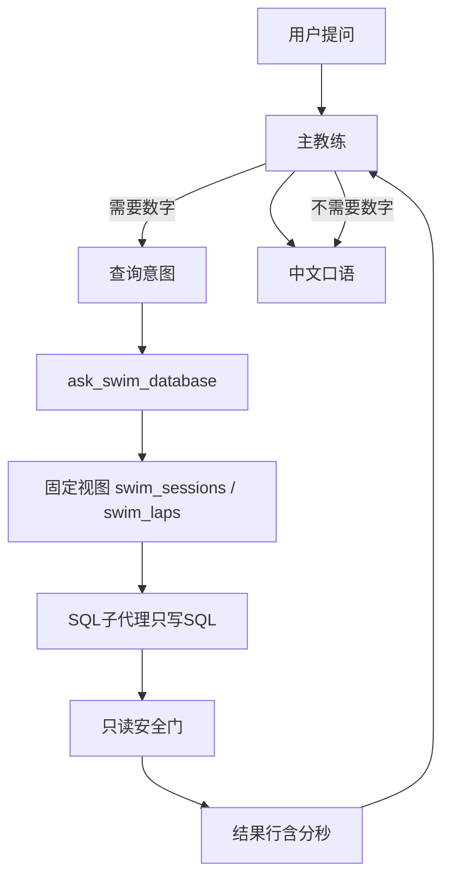

# 游泳教练双 Agent 架构优化方案

> 状态：讨论与设计文档（先对齐，再动手）  
> 日期：2026-10-23  
> 相关代码：`agent/src/coach_agent.py`（主教练）、`agent/src/sql_agent.py`（SQL 子代理）、`agent/skills/swim-coach/`  
> 对照文档：
>
> - [LangChain SQL Agent](https://docs.langchain.com/oss/python/langchain/sql-agent)
> - [Deep Agents Skills](https://docs.langchain.com/oss/python/deepagents/skills)

本文说明：**现在怎么跑、哪里不优雅、目标长什么样、分几步改、Skills 该怎么挂**。  
落地前以本文为准；已改过的代码若与本文冲突，以本文结论回退或重做。

---

## 1. 目标一句话

用户提问后：

1. **主教练**判断要不要查数、写出**查询意图**、组织口语；
2. 需要数字时调用 **SQL 子代理**（工具 `ask_swim_database`）；
3. SQL 子代理只对**固定两张视图**写 SQL、安全执行、返回结果行；
4. 主教练按结果行说话，不自己算、不写 SQL。

每个角色的 prompt 要短；代码分块清晰；主从调用链一眼能看懂。

---

## 2. 现状：调用链其实是什么

### 2.1 主教练就是 `agent_runtime.py`

是的。`create_coach_agent()` 用 Deep Agents 的 `create_deep_agent` 建图。  
SQL **不是**另一个独立进程，而是被包成工具挂进主教练：

```text
create_coach_agent()
  → build_swim_sql_tool(model, repo)  → 得到工具 ask_swim_database
  → tools = [档案工具..., ask_swim_database]
  → create_deep_agent(tools=..., system_prompt=..., skills=["/skills/"], ...)

用户提问
  → ask_agent_stream() / ask_agent()
  → 主教练 tool_call: ask_swim_database(查询意图)
  → sql_agent: 刷新视图 → 模型写 SQL → 安全门执行 → 返回行
  → 主教练口语回答
```

### 2.2 为什么「看不懂怎么调 SQL」

调用点挤在 `create_coach_agent` 里一行挂工具；同文件后半截又是流式过滤、等待语、防摘要泄漏。  
业务编排与设备适配糊在一起，所以读起来不像「主 Agent → SQL Agent」。

### 2.3 目标数据流



| 角色 | 负责 | 不负责 |
|------|------|--------|
| 主教练 | 意图、是否查数、查询意图措辞、档案/CSS、口语、主题卡 | 写 SQL、直接碰库 |
| SQL 子代理 | 理解意图、对两表写一条 SQL、执行、返回行 | 口语、训练建议、档案 |

---

## 3. 核心问题诊断

### 3.1 SQL 侧：曾经「官方 SQL Agent 全家桶」过重

官方 SQL Agent 教程常见路径：

`list_tables → schema → checker → query` 多轮工具循环。

我们只有两张固定表，再挂 list/schema/checker 会：

- 多轮模型调用 → 更慢、更贵；
- 提示与规则膨胀 → 「最近 + 从早到晚」互相打架（曾查成最早三场）。

**结论：** SQL 侧采用**薄子代理**：固定视图 + 短 schema 提示 + 只写一条 SQL + 程序只读安全门。  
不上完整四工具循环。

### 3.2 主侧：Deep Agents 在用，但 Skills **没有按官方方式用**

官方 [Deep Agents Skills](https://docs.langchain.com/oss/python/deepagents/skills) 约定：

1. `skills/` 下每个技能一个子目录 + `SKILL.md`（YAML frontmatter：`name` / `description`）；
2. `create_deep_agent(..., backend=..., skills=["./skills/"])`；
3. **启动时只把 name + description 放进系统提示**；
4. 任务匹配时，Agent **再去读**完整 `SKILL.md` 与 `references/`（progressive disclosure）。

我们仓库里已有：

- `agent/skills/swim-coach/SKILL.md`
- `agent/skills/swim-coach/references/*.md`
- `create_deep_agent(..., skills=["/skills/"], backend=FilesystemBackend(...))`

但同时还有：

```python
# 现状（反模式相对官方 Skills）
system_prompt = 短说明 + _skill_body()   # 每轮把 SKILL.md 全文塞进系统提示
```

历史原因（代码注释）：框架 pinned skills 摘要后可能丢失，于是改为**每轮硬塞全文**，绕过了官方的「先摘要、再按需读取」。

因此：

| 项目 | 官方 Skills | 我们现状 |
|------|-------------|----------|
| `skills=` 参数 | 用于渐进披露 | 有传，但价值被绕过 |
| 启动上下文 | 仅 name/description | 全文 SKILL 进 system_prompt |
| 参考卡 | 技能内指引再读 | 技能里写 `read_file`，同时全文已在上下文 |
| Token / 清晰度 | 启动轻、按需重 | 每轮重、提示臃肿 |

**结论：** 现在是「Deep Agents 壳 + 手工灌技能」，**不是**官方文档那种 Skills 挂载用法。这是下一轮主 Agent 整理的重点之一。

### 3.3 提示词与补丁叠床架屋

- 系统提示、SKILL、工具 docstring 重复同一规则；
- 「禁止 ASC LIMIT」一类语义补丁进提示词 / Python，掩盖的是**意图契约不清**（父代理把「从早到晚」写进查询意图）。

**结论：** 意图只写「查什么」；展示顺序由程序处理；提示词分家且短。

---

## 4. 优化原则（拍板用）

1. **主从分离**：说话的不写 SQL；写 SQL 的不说话。  
2. **SQL 薄做**：固定两表视图；安全门只做只读/单语句/行数上限。  
3. **Skills 走官方路径**：启动只挂摘要；正文与参考卡按需 `read_file`；系统提示不再粘贴 SKILL 全文（需验证摘要后是否仍可靠）。  
4. **查询意图契约**：例如「最近三场的距离」，不附带「按时间从早到晚」展示话术。  
5. **代码分块**：`========` 隔开大块；调用链写在「创建主教练」块注释里。  
6. **本轮不迁框架**：暂留 Deep Agents；迁到纯 `create_agent` 单独立项。  
7. **本轮不做**：完整 SQL toolkit 循环、固件/OTA、负荷「今日课型三选一」产品包。

---

## 5. 目标结构（文件级）

### 5.1 `coach_agent.py`（主教练，由 `agent_runtime.py` 改名）

框架仍是 `create_deep_agent`（与官方一致）；文件改名只为辨认。

建议分块：

1. 常量与路径  
2. 主教练**短**系统提示（主从契约；**不含** SKILL 全文）  
3. **创建主教练**：显式 `build_swim_sql_tool` → `skills=["/skills/"]` → `create_deep_agent`  
4. 会话入口 `ask_agent` / `ask_agent_stream`  
5. 流式过滤与设备等待语（次要）

调用链注释必须让新人能画出主从图。

### 5.2 `sql_agent.py`（SQL 子代理）

对齐「设库 → 工具 → 运行」：

1. 设库 / 刷新固定视图 `swim_sessions`、`swim_laps`（**表结构写死在代码**；数据从 evidence 拷贝）  
2. 执行工具：安全门 + SELECT  
3. SQL 角色短提示（schema + 单位 +「最近 = DESC」一句）  
4. 运行：写 SQL → 执行 →（可选）结果行时间重排  
5. `build_swim_sql_tool` → `ask_swim_database`

多方面数据：一条 SQL 多指标，或主教练本轮多次调用工具；分析仍在主教练。

### 5.3 Skills 目录（官方形态）

```text
agent/skills/
  swim-coach/
    SKILL.md                 # frontmatter + 短主循环
    references/
      turn-protocol.md       # 语音回合预算（每轮通用）
      intent-analysis.md     # 需求 → 查询意图 / 主题选用
      queryable-data.md      # 可查口径与意图示例（无 DDL）
      voice-style.md         # 口语风格
      common.md              # 共用执教口径
      efficiency.md … trend.md
      css.md
```

`SKILL.md` 的 `description` 要写清楚触发条件。主题卡按意图**自主**选用（不要求用户点名），每轮至多一张。真实列名只留在 SQL 子代理提示里。

### 5.4 动手前检查清单（具体改什么）

按本清单实施即达到第 5 节目标。勾选 = 本轮要改。

**A. 文件与命名**

- [x] `agent/src/agent_runtime.py` → `agent/src/coach_agent.py`
- [x] 更新引用：`api.py`、`cli.py`、`sql_agent.py`、`DEVELOPMENT.md`、相关文档路径
- [x] 保留符号名：`create_coach_agent`、`ask_agent`、`ask_agent_stream`、`ask_swim_database`

**B. 主教练 `coach_agent.py`（§5.1）**

- [x] `========` 分成 5 块；第 3 块注释写清主→SQL 调用链
- [x] 删除 `_skill_body()` 全文拼接；系统提示仅短硬约束
- [x] 继续 `create_deep_agent(..., skills=["/skills/"], backend=...)`
- [x] `_with_tool_nudge` **已去掉**，先观察模型是否会自行调工具
- [x] 流式过滤 / 等待语 / `notify_query_started` 留在第 5 块

**C. SQL 子代理 `sql_agent.py`（§5.2）**

- [x] 整理为 5 块：设库 → 安全执行 → 短提示 → 运行 → 暴露工具
- [x] 视图保持写死两表 + evidence 拷数据（不动态反射 schema）
- [x] 提示词仅 schema/单位/「最近=DESC」；无 ASC 长补丁
- [x] 无「最近却 ASC」语义拦截；从早到晚只在结果行重排
- [x] 保留安全门：只读、单 SELECT、行数上限、分秒列

**D. Skill `swim-coach/SKILL.md`（§5.3）**

- [x] 强化 frontmatter `description`
- [x] 流程第 2 步：先调工具；参数=短意图；禁止空口承诺
- [x] 新增「可查口径」+ 3～5 条意图示例（不贴 CREATE TABLE）
- [x] 主题卡仍 `read_file`；依赖官方 progressive disclosure

**E. 本轮不改**

- [x] 不上 SQL 四工具循环；不改固件/OTA；不做负荷三选一；不换离 Deep Agents；不 PRAGMA 动态建视图

**F. 验收**

- [x] 打招呼不查库（本地冒烟已过）
- [x] 最近一场距离正确（约 1020 米）
- [x] 最近三场为 1020/1590/1740，不是最早三场
- [ ] 采访轮能追问（nudge 过猛则记录）
- [x] 启动系统提示不再含 SKILL 全文（338 字短契约）；按需读 skill/references 仍待对话日志观察

---

## 6. 分阶段落地计划

### 阶段 A — 可读性与调用链（优先）

**目的：** 人能读懂；行为大体不变。

- [x] `coach_agent` / `sql_agent` 按上节分块  
- [x] 删除语义补丁型逻辑（如「最近却 ASC」拦截句）；保留真正安全门与分秒列  
- [x] 查询意图示例改为短意图；展示顺序用程序重排  

**验收：** 只读第 3 块注释能画出主从调用图。

### 阶段 B — 提示词瘦身 + 意图契约

**目的：** 主/SQL prompt 短；规则不三处重复。

- [x] 系统提示只保留主从契约与禁止空承诺  
- [x] `SKILL.md` 流程第 2 步：先调工具、参数=意图  
- [x] `_with_tool_nudge`：已去掉，先测模型是否自行调工具  

**验收：** 「最近三场距离」得到正确最近三场（约 1740 / 1590 / 1020），不是最早三场。

### 阶段 C — Deep Agents Skills 正统化（建议紧接 B，或单独一轮）

**目的：** 与官方 Skills 文档对齐。

| 步骤 | 做法 | 风险与验证 |
|------|------|------------|
| C1 | 去掉 `build_system_prompt` 里的 `_skill_body()` 全文拼接 | 摘要后是否丢技能 → 多轮对话回归 |
| C2 | 仅依赖 `skills=["/skills/"]` + frontmatter 摘要 | 确认启动提示里出现 skill 描述 |
| C3 | 技能正文指引：匹配后读 `/skills/swim-coach/SKILL.md`；主题再用 `read_file` 读 references | 与现有参考卡路径对齐 |
| C4 | 系统提示保留**极短**硬约束（禁编造、必调工具查数、禁 task/write） | 防技能未激活时翻车 |
| C5 | 若摘要中间件仍吞技能：再评估是否替换摘要策略，而不是重回「全文灌进 system」 | 避免走回头路 |

**验收：**

1. 启动上下文**不再**含整份 SKILL 正文，仅有 skill 名/描述（或等价摘要）；  
2. 问效率/CSS 时，日志或轨迹中能看到对 `SKILL.md` / `references/*.md` 的读取；  
3. 打招呼仍不查库；最近一场/三场数字正确。

### 阶段 D — 后置（不阻塞 A–C）

- 固定视图改为启动/变更时刷新，避免每次提问全量删建  
- 负荷解释 + 今日课型三选一（产品评估下一包）  
- 评估是否迁移离 Deep Agents 到纯 `create_agent`（大项，单独立项）

---

## 7. Skills 正统化：目标代码形态（示意）

```python
backend = FilesystemBackend(root_dir=str(AGENT_ROOT), virtual_mode=True)

agent = create_deep_agent(
    model=model,
    tools=[*profile_tools, build_swim_sql_tool(model, repo)],
    # 仅短硬约束，不含 SKILL 全文
    system_prompt=SHORT_COACH_CONTRACT,
    backend=backend,
    # 官方用法：技能目录（内含 swim-coach/SKILL.md）
    skills=["/skills/"],
    middleware=[filesystem, _NoConversationSummary()],
    checkpointer=checkpointer,
)
```

`SHORT_COACH_CONTRACT` 示例职责（保持短）：

- 中文口语教练；数字只来自 `ask_swim_database`；
- 需要数字先调工具再开口；参数=查询意图；
- 不写 SQL；不编造；不调 task/write/edit/delete/execute；
- 详细流程与主题卡见已挂载的 swim-coach skill（由框架按需加载）。

---

## 8. 与「已改代码」的关系

§5.4 A–E 已落地：`coach_agent.py` + 短 `SHORT_COACH_CONTRACT` + `skills=["/skills/"]`，不再 `_skill_body()` 全文硬塞。  
采访轮与「日志里可见 read_file 技能」仍可在日常对话里继续观察。

---

## 9. 验收清单（关门用）

1. 新人只读 `coach_agent`「创建主教练」块 + `sql_agent` 目录注释，能画出主从图。  
2. 「最近三场距离」= 时间最新三场，不是库内最早三场。  
3. 主/SQL 提示词短；无「禁止 ASC」类补丁句。  
4. Skills：启动轻量摘要 + 按需读 `SKILL.md`/references（阶段 C）。  
5. 本地 `cli chat` + 设备冒烟：打招呼、最近一场、最近三场、CSS 无锚点引导。

---

## 10. 讨论结论（已拍板）

1. 主 Agent **已是** `create_deep_agent`；本轮补齐官方 Skills 用法（去全文硬塞）。  
2. 文件改名为 `coach_agent.py`。  
3. 固定视图：结构写死、数据从 evidence 拷。  
4. SQL 一次一条 SELECT；多方面靠多指标 SQL 或主教练多次调工具。  
5. `_with_tool_nudge` **已去掉**（先测模型能力）；Skills 正统化与 A/B 同一迭代做到 §5。  
6. Skill 加「可查口径/意图示例」，不加完整 DDL。

§5.4 已按清单改完代码；验收 F 中采访轮与 skill 按需读取轨迹可继续用 `python -m src.cli chat` 观察。
